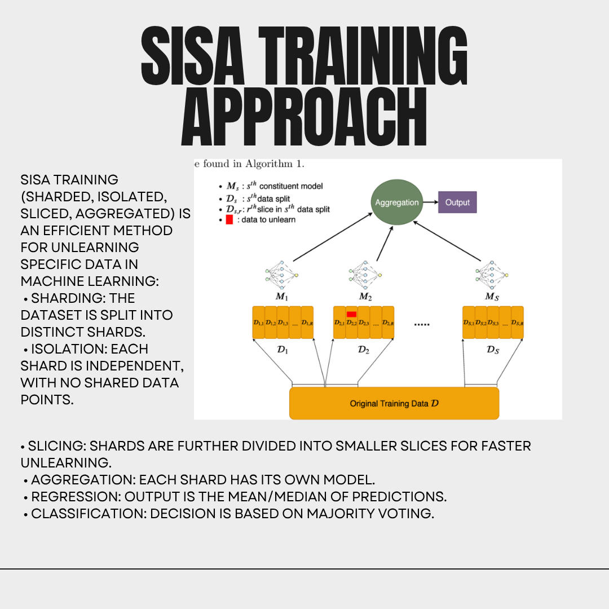
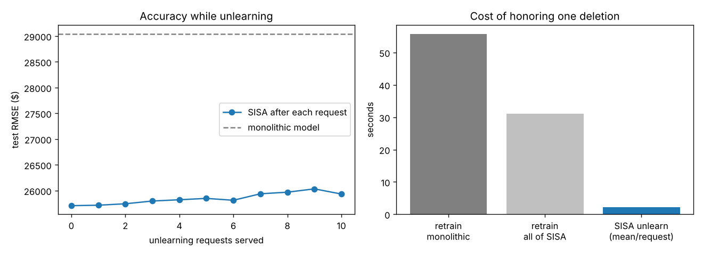
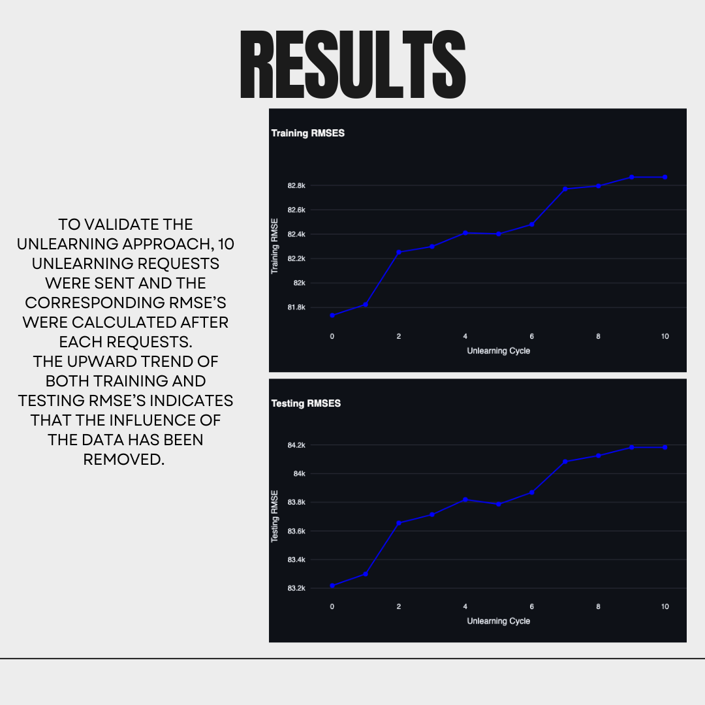

# MUnL — Machine Unlearning with SISA Training

**Make a trained neural network forget specific records — exactly, and without retraining from scratch.**

MUnL implements **SISA training** (Sharded, Isolated, Sliced, Aggregated; [Bourtoule et al., IEEE S&P 2021](docs/Bourtoule2021_MachineUnlearning.pdf)) for a loan-amount regression task on Fannie Mae (FNMA) loan-level data. When a borrower asks to be forgotten (GDPR "right to erasure", CCPA "right to delete"), deleting their row from a database isn't enough: the model trained on it still carries its influence. SISA bounds that influence so that removing it costs a fraction of a full retrain.

<p align="center">
  
</p>

---

## How it works

1. **Shard** – the training set is randomly partitioned into `S` disjoint shards.
2. **Isolate** – one model is trained per shard and never sees another shard's data.
3. **Slice** – each shard is split into `R` slices fed in incrementally (slice 1, then 1–2, then 1–3, …). After each step the **model and optimizer state** are checkpointed.
4. **Aggregate** – predictions are the mean (or median) of the shard models.

**Unlearning record _x_** in shard _s_, slice _r_:

1. Physically delete _x_ from slice _r_.
2. Restore shard _s_ to its checkpoint from *before* slice _r_ was introduced.
3. Replay slices _r … R_ on the remaining data.

Every other shard is untouched. Expected cost per request drops from "retrain everything" to roughly `1/S × (R − r)/R` of it. Each slice is trained from a fixed seed, so **the unlearned ensemble is bit-for-bit identical to one that never trained on _x_.** The test suite checks this.

---

## Quick start

```bash
pip install -r requirements.txt        # or: pip install -e ".[dev]"

# No dataset? Every command accepts --synthetic N for a same-schema synthetic dataset.
python -m munl train     --synthetic 20000 --shards 10 --slices 5 --out runs/sisa.pt
python -m munl unlearn   --model runs/sisa.pt --ids 1007 1014 1021
python -m munl evaluate  --model runs/sisa.pt
python -m munl benchmark --synthetic 20000 --requests 10 --out runs/benchmark
```

With the real data:

```bash
python -m munl train --data "data/fnma loan data.csv" --shards 20 --slices 10 --epochs 3
python -m munl unlearn --model runs/sisa.pt --ids-file deletion_requests.txt
```

`unlearn` takes **Record Numbers** from the CSV. Requests in one call are batched, so each affected shard is retrained once, starting from the earliest slice that held a deleted record.

### Python API

```python
from munl import SISAConfig, SISAEnsemble, load_fnma, prepare

data = prepare(load_fnma("data/fnma loan data.csv"))
ens = SISAEnsemble(SISAConfig(num_shards=10, num_slices=5), data.n_features)
ens.fit(data.train.X, data.train.y, data.train.ids)

report = ens.unlearn([2194514])
print(report.summary())   # removed 1/1 records in 0.84s; retrained 3 slice steps (shard 4 from slice 2)
dollars = data.to_dollars(ens.predict(data.test.X))
```

A step-by-step walkthrough, including the exactness check, is in [`notebooks/MUnL_walkthrough.ipynb`](notebooks/MUnL_walkthrough.ipynb).

---

## Dataset

**FNMA single-family loan-level data** (Fannie Mae & Freddie Mac public use database, via Kaggle), a ~88k-row sample (~3.5% of the original). The CSV is not included in this repo: put it under `data/` (git-ignored).

| Role | Columns |
|---|---|
| **Target** | Acquisition Unpaid Principal Balance (UPB) |
| **Numeric features** (median-imputed, standardized) | Borrower annual income, area median family income, tract income ratio, census-tract median income, number of borrowers, rate spread |
| **Categorical features** (one-hot, rare levels pooled) | Loan purpose, first-time buyer, federal guarantee, property type, occupancy, state, MSA code, lien status |
| **Identifier** (not a feature) | Record Number — used to address deletion requests |

The target is standardized for training. All reported metrics are back in dollars.

## Model

Each shard model is an MLP, `in → 512 → 512 → 64 → 1`, with ReLU, dropout 0.3, Adam (lr 1e-3) and MSE loss. Everything is configurable through `SISAConfig` / CLI flags.

---

## Results

`python -m munl benchmark` trains a single monolithic model (the "retrain from scratch" baseline) and a SISA ensemble, then serves a sequence of single-record deletion requests, recording time and test error after each one. It writes `benchmark.json` and a plot like the one below.

**Synthetic data** (20,000 rows; 10 shards × 5 slices, 5 epochs per slice step; CPU). Reproduce with `python -m munl benchmark --synthetic 20000 --shards 10 --slices 5 --epochs 5 --requests 10`:

| | Test RMSE | R² | Cost to honor one deletion |
|---|---|---|---|
| Monolithic model (retrain from scratch) | $29,046 | 0.945 | 55.7 s |
| SISA, retrain every shard | $25,707 | 0.957 | 31.2 s |
| **SISA unlearning** (mean of 10 requests) | $25,707 → $25,936 | 0.957 | **2.1 s (≈26× faster)** |

<p align="center"></p>

Each request retrained a single shard, between 1 and 5 slice steps depending on where the record sat. The synthetic target is a simple function of a few features, so here the ensemble even beats the monolithic model. **Expect a larger accuracy gap on the real FNMA data**, which hasn't been re-benchmarked with this version yet (the CSV isn't in the repo). Run the same command with `--data` to get those numbers.

What to expect, in line with the SISA paper:

* **Unlearning cost** falls roughly with the number of shards, and further with slices (on average only half of a shard's slices need replaying).
* **Accuracy** trails a monolithic model somewhat, since each shard model sees only `1/S` of the data. More shards means cheaper unlearning but weaker constituent models.
* **Storage** grows with `S × R` checkpoints. That's the price of the speed-up.

<details>
<summary>Results from the original notebook (legacy, see caveats below)</summary>

<p align="center"></p>

The original notebook reported a test RMSE of about $79.7k for the single model and $83.2k–$84.2k for the 30-shard × 25-slice SISA ensemble across 10 unlearning requests. Because of the bugs listed below, the unlearning in that run did not actually change the affected shard model, so these numbers should not be read as evidence of unlearning.
</details>

---

## What changed in v0.2 (the overhaul)

The original implementation (kept for reference in [`notebooks/legacy/MUnL_original.ipynb`](notebooks/legacy/MUnL_original.ipynb)) demonstrated the idea, but several bugs meant that **no data was actually unlearned**:

| Problem in the original notebook | Effect | Fix |
|---|---|---|
| Checkpoints stored with `model.state_dict()` (live references, not copies) | Every "checkpoint" was the final model; rolling back was impossible | Deep-copied snapshots of model **and** Adam state |
| Unlearning reused the `optimizer` of the *last* shard trained | Gradients were never applied to the affected shard: unlearning was a no-op | Each retrain restores its own shard's model + optimizer |
| Retraining continued from the final weights instead of the pre-slice checkpoint | The deleted point's influence stayed in the weights | Restore the checkpoint taken before the affected slice |
| Replay started from `x_slice[:slice_idx + 1]` and dropped earlier slices | The shard was retrained on a handful of rows | Replay on slices `0..r` cumulatively, exactly as in training |
| `X_train` / `y_train` overwritten inside the shard loop | "Train RMSE" was measured on one shard only | Training data kept separate from loop variables |
| Evaluation ran with dropout active | Noisy, pessimistic metrics | `model.eval()` / `torch.no_grad()` for inference |
| `Record Number` used as an input feature | An ID column fed to the network as a number | Used only to address deletion requests |
| State / MSA / purpose codes standardized as numbers | Meaningless ordinal relationships | One-hot encoding |
| Target trained on raw dollars (loss ~10⁹) | Poorly conditioned optimisation | Standardized target, metrics reported in dollars |
| "Accuracy = 1 − RMSE / range" | Near 100% even for poor models | RMSE, MAE and R² |
| Remainder rows dropped when sharding (`len // num_shards`) | Training data silently discarded | `np.array_split` keeps every row |
| Deleted rows located by float matching over all slices (`torch.allclose`) | Slow; could hit the wrong row on duplicates | O(1) record-id → (shard, slice) index |
| 100 epochs per slice step (2,500 epochs per shard) | Hours of training | Configurable `epochs_per_slice` (default 5) |
| Single notebook with `input()` prompts, no tests | Hard to reproduce or reuse | `munl` package, CLI, persistence, pytest suite |

---

## Project structure

```
munl/
  data.py       loading, schema, preprocessing, synthetic data generator
  model.py      MLP and a seeded, deterministic training loop
  sisa.py       SISAEnsemble: partitioning, checkpointed training, unlearning, save/load
  metrics.py    RMSE / MAE / R² in dollars
  cli.py        `python -m munl train | unlearn | evaluate | benchmark`
tests/          exactness, isolation, determinism and persistence tests
notebooks/      walkthrough notebook (+ legacy original)
docs/           the SISA paper (Bourtoule et al.)
assets/slides/  project presentation slides
```

Run the tests with `pytest` (about a minute on CPU, using synthetic data).

## Limitations & next steps

* Exactness holds on a given device and PyTorch build. Some GPU kernels are non-deterministic, so bit-for-bit equality is only guaranteed on CPU.
* The saved ensemble includes the remaining training rows (they're needed to replay slices). Protect it like the raw data.
* Possible next steps: distribution-aware sharding (put likely-to-be-deleted records in late slices, as in §VI of the paper), parallel shard training, a membership-inference audit to measure forgetting empirically, and a classification variant (e.g. loan approval) with majority-vote aggregation.

## Reference

Lucas Bourtoule, Varun Chandrasekaran, Christopher A. Choquette-Choo, Hengrui Jia, Adelin Travers, Baiwu Zhang, David Lie, Nicolas Papernot. **Machine Unlearning.** *42nd IEEE Symposium on Security and Privacy*, 2021. [arXiv:1912.03817](https://arxiv.org/abs/1912.03817)

## Author

**Viraj Mankani**
